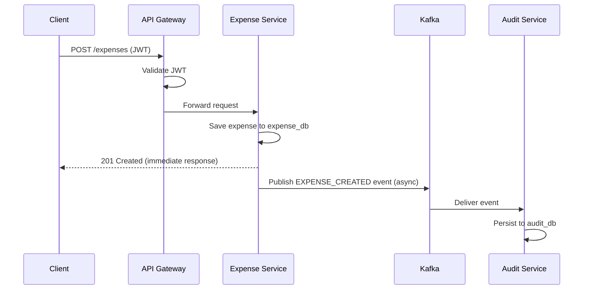

# Enterprise Expense & Audit Management Platform

A microservices-based expense management system built with Java 21 and Spring Boot 3,
demonstrating production-style patterns: JWT authentication, async event-driven audit
logging via Kafka, Redis caching, an API Gateway, service-to-service communication via
OpenFeign, and full containerized deployment (Docker Compose + Kubernetes).

This is a personal portfolio project built to practice and demonstrate backend engineering
concepts for Java/Spring Boot developer roles. It is not a production system and has not
served real traffic.

## 1. Architecture

```
                        ┌─────────────┐
                        │   Client    │
                        └──────┬──────┘
                               │
                   ┌───────────────────────┐
                   │   API Gateway (8080)  │
                   │  Spring Cloud Gateway │
                   └──────────┬────────────┘
           ┌──────────────────┼──────────────────┐
           ▼                  ▼                  ▼
   ┌───────────────┐  ┌───────────────┐  ┌───────────────┐
   │ Auth Service  │  │Expense Service│  │ Audit Service  │
   │   (8081)      │  │   (8082)      │  │   (8083)       │
   └───────┬───────┘  └───────┬───────┘  └───────▲────────┘
           ▼                  ▼                   │
   ┌───────────────┐  ┌───────────────┐           │
   │  auth_db      │  │  expense_db   │           │
   └───────────────┘  └───────┬───────┘           │
                               ├──────▶ Redis      │
                               └──────▶ Kafka ─────┘
                                                    ▼
                                            ┌───────────────┐
                                            │   audit_db    │
                                            └───────────────┘
```



## 2. Technologies

Java 21 · Spring Boot 3.3 · Spring Security · Spring Data JPA · Spring Cloud Gateway ·
OpenFeign · PostgreSQL 16 · Redis 7 · Apache Kafka (KRaft mode) · JWT (jjwt) · Docker ·
Docker Compose · Kubernetes · Jenkins · Prometheus · Grafana · JUnit 5 · Mockito · Lombok

## 3. Services

| Service | Port | Responsibility |
|---|---|---|
| API Gateway | 8080 | Single entry point, routing, first-pass JWT validation |
| Auth Service | 8081 | Registration, login, JWT issuance, user lookup |
| Expense Service | 8082 | Expense CRUD, approval workflow, Redis-cached summary |
| Audit Service | 8083 | Kafka consumer, immutable audit trail, filterable audit log API |

## 4. Database Design

Each service owns its own database — no cross-service queries, no shared schemas.

- `auth_db.users` (id, name, email, password [BCrypt hash], role, created_at)
- `expense_db.expenses` (id, employee_id, amount, category, description, status, created_at, updated_at) — indexed on `employee_id`, `status`
- `audit_db.audit_logs` (id, user_id, event, service, status, description, correlation_id, timestamp) — indexed on `user_id`, `event`, `timestamp`

## 5. API Reference

### Auth Service
| Method | Path | Auth Required | Description |
|---|---|---|---|
| POST | `/auth/register` | No | Register a new user |
| POST | `/auth/login` | No | Login, returns JWT |
| GET | `/auth/users/{id}` | Yes | Fetch user details (internal, used by Feign) |

### Expense Service
| Method | Path | Auth Required | Description |
|---|---|---|---|
| POST | `/expenses` | Yes | Create expense |
| GET | `/expenses/{id}` | Yes (owner/manager) | Get one expense |
| GET | `/expenses/my` | Yes | Paginated, own expenses |
| GET | `/expenses` | Yes (manager/admin) | Paginated, all expenses |
| GET | `/expenses/summary` | Yes | Cached aggregate summary |
| GET | `/expenses/{id}/with-user` | Yes | Expense enriched with employee name/email (Feign) |
| PUT | `/expenses/{id}` | Yes (owner/manager) | Update (PENDING only) |
| DELETE | `/expenses/{id}` | Yes (owner/manager) | Delete |
| PUT | `/expenses/{id}/approve` | Manager/Admin | Approve |
| PUT | `/expenses/{id}/reject` | Manager/Admin | Reject |

### Audit Service
| Method | Path | Description |
|---|---|---|
| GET | `/audit-logs/{id}` | Get one audit log |
| GET | `/audit-logs` | Paginated + filterable (`userId`, `event`, `status`, `service`, `startDate`, `endDate`) |

## 6. Kafka Flow

`expense-service` publishes to the `audit-events` topic on every state-changing action
(create/update/approve/reject). `audit-service` consumes independently via its own
consumer group (`audit-service-group`). If Audit Service is down, events remain in
Kafka and are processed once it recovers.

## 7. Redis Flow

`GET /expenses/summary` uses cache-aside: check Redis → on miss, query Postgres and
populate the cache (10-minute TTL) → any write operation explicitly invalidates the
cache key.

## 8. Authentication Flow

Stateless JWT, verified independently by the Gateway (fast-fail) and by each service
(actual authorization boundary). BCrypt password hashing. Role-based (`USER`, `MANAGER`,
`ADMIN`) plus row-level ownership checks for expense access.

## 9. Local Development

```bash
git clone <repo-url>
cd enterprise-expense-platform
cp .env.example .env
docker compose up --build
```

All services reachable via the Gateway at `http://localhost:8080`. See `/docs/api-examples.md`
for full cURL examples for every endpoint.

## 10. Testing

```bash
cd auth-service && mvn test
cd expense-service && mvn test
cd audit-service && mvn test
```

Unit tests cover: registration/login/invalid-credential flows (Auth), CRUD/ownership/approval-
workflow/cache logic (Expense), Kafka event mapping and poison-pill handling (Audit).

## 11. Kubernetes Deployment

```bash
kubectl apply -f k8s/
kubectl get pods -n expense-platform
```

See `/k8s` for manifests. Self-healing can be demonstrated by manually deleting a running
Pod and observing automatic replacement.

## 12. Monitoring

Prometheus scrapes `/actuator/prometheus` on all four services (`/monitoring/prometheus.yml`).
Grafana dashboard concept: request rate, error rate, P95 latency, JVM heap, Kafka consumer
lag, active DB connections.

## 13. Known Limitations (honest, by design)

- Single Postgres container hosting three databases (local-dev simplification; production
  would use separate managed instances)
- `emptyDir` volumes in Kubernetes manifests (no persistence across Pod restarts — would
  use a `PersistentVolumeClaim` in production)
- No circuit breaker (Resilience4j) on the OpenFeign call — currently a plain try/catch
  with timeouts
- No dead-letter topic for malformed Kafka messages — currently logged and dropped
- Base64 Kubernetes Secrets, not a real secrets manager (Vault/AWS Secrets Manager)
- Fixed `replicas: 2`, not a HorizontalPodAutoscaler
- No optimistic locking on concurrent expense approval (a documented, acknowledged race condition)

## 14. Future Improvements

- Resilience4j circuit breaker on the Feign client
- Transactional outbox pattern for guaranteed Kafka publishing
- OpenTelemetry/Jaeger distributed tracing (replacing the hand-rolled correlation ID)
- Refresh tokens for JWT
- `@Version`-based optimistic locking on `Expense`

## 15. Example Requests

See `/docs/api-examples.md` for the complete set of cURL requests and expected responses.
